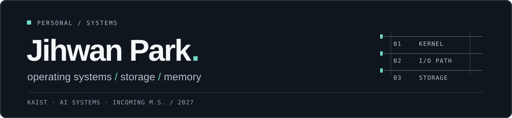

  

I'm an incoming **M.S. student in AI Systems at KAIST (Spring 2027)**, joining the **Operating Systems Laboratory**.

I studied computer science and electronic engineering at Kyung Hee University. My work has taken me from Linux infrastructure and stateful services to memory-constrained ML and FPGA acceleration. Now I'm digging deeper into how operating systems, I/O, and storage work.

### Currently interested in

| Area | Topics I'm exploring |
| :--- | :--- |
| **Operating systems** | Linux kernel, VFS, file systems, I/O paths, performance tracing |
| **Storage & memory** | Flash / SSD, NVMe, memory management, efficient data movement |
| **Systems & hardware** | Hardware-aware execution, performance trade-offs, reliable infrastructure |

### Things I've worked on

- **TensorFlow Lite Micro · Memory planning** — Analyzed tensor lifetimes, conflicts, and opportunities for buffer reuse. Project evaluation showed peak-memory reductions of **28.33%** (Person Detect) and **14.06%** (Tiny U-Net) against the original allocation plan.
- **Zynq FPGA · CNN accelerator** — Explored quantization, bit-shift arithmetic, IM2COL, and systolic-array dataflow. Project evaluation reported **36.5% less FPGA area** and **8.83 ms PS+PL runtime**, compared with **15.9 ms PS-only**.
- **Linux infrastructure · Operations** — Worked with K3s/Kubernetes, private registries, persistent storage, and recovery planning in a restricted-network environment.

[Read more about my projects and experience →](https://petooooo.github.io/cv/)

### Technologies

| | |
| :--- | :--- |
| **Languages** | `C` · `C++` · `Python` · `Shell` · `TypeScript` · `SQL` |
| **Systems** | `Linux` · `Git` · `Docker` · `Kubernetes / K3s` · `Longhorn` |
| **Data & infrastructure** | `ClickHouse` · `MinIO` · `MongoDB` · `Nexus` |
| **Hardware / embedded** | `Verilog` · `FPGA` · `Zynq` · `TensorFlow Lite Micro` |

**[Website](https://petooooo.github.io/)** · **[Projects & CV](https://petooooo.github.io/cv/)** · **[Engineering notes](https://petooooo.github.io/notes/)** · **[Operations notes](https://petooooo.github.io/devops/)**

Current research interests are directions I'm exploring, not claims of completed research.
